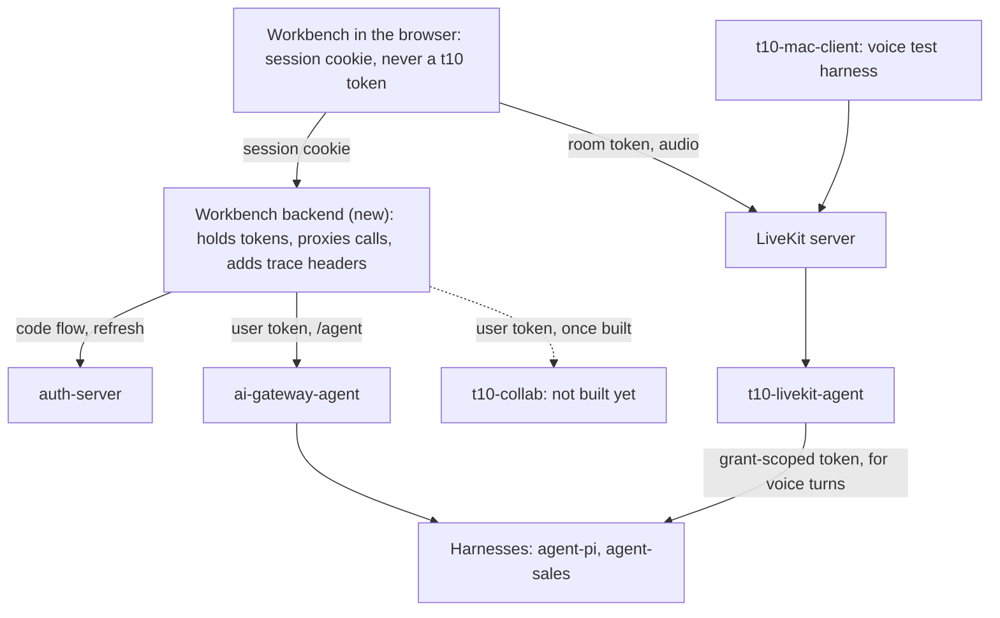
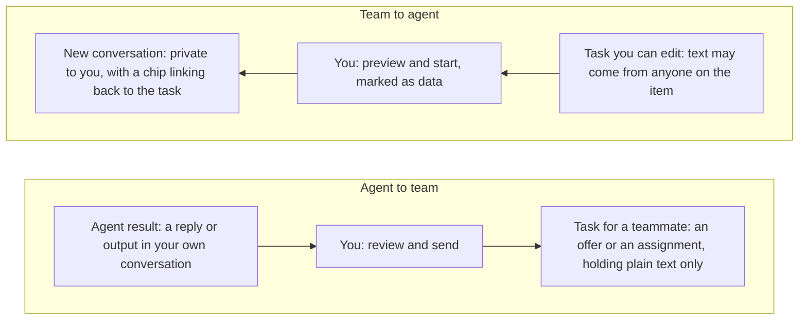
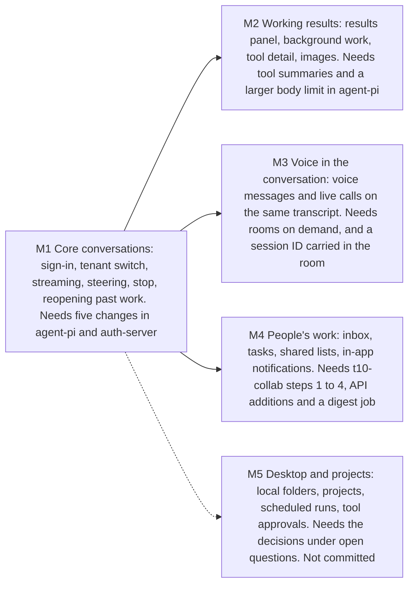

# T10 Workbench Design

Oct 31, 2026 · @Felix Liang

Status: in progress. M1, most of M2, the client side of M3 and M4 on what `t10-collab` has so far are built. See "Implementation status".

## Summary

Build `workbench`, the web client where people work with their t10 agent, on a three-pane layout: conversations, the active conversation, and its results. It is a React app served by a small Go backend, which holds tokens and proxies `/agent`, the auth service, business modules such as `t10-collab`, and voice admission. On the cluster `/agent` goes to `ai-gateway-agent`, which places sessions across agents and replicas. With no gateway it goes straight to a harness such as `agent-pi`.

Five decisions keep it small:

1. **Web first, behind its own backend.** The auth design already reserves a confidential web backend, and the auth service sets no CORS headers. The browser holds a cookie, never a t10 token.
2. **`agent-pi` owns conversations.** The workbench stores no transcript. It adds one table, for its own browser sessions.
3. **One live stream per open conversation.** Prompts are plain requests, and all output arrives on `GET /agent`. Reconnects, a second tab and a restarted agent then follow one path.
4. **Two kinds of work stay two kinds.** "Tasks" means people's work from `t10-collab`. Agent work is shown as "Background work", matching the separation in the collab design. A person moves work between them.
5. **Voice joins the same conversation.** A call happens inside a conversation, not in a separate app, so the workbench needs rooms created on demand.

The client can't ship on what exists today. `agent-pi` has no way to read a past conversation back, and it caps a user at 20 open sessions by default. Milestone 1 closes both. Collaboration also needs three small additions to the collab design, so that a sender knows what a send will do, plus a daily digest, so that work gets noticed outside the app.

## Implementation status

The client is built as far as its sibling repos allow, as of Nov 1, 2026. The `agent-pi` and `auth-server` changes M1 needs are in their working trees, uncommitted.

| Milestone | State | What's missing |
| --- | --- | --- |
| M1 Core conversations | Built. All six exit criteria pass in browser tests, against a real auth service and `agent-pi` with a scripted model | Commit the sibling changes |
| M2 Working results | Built | Tool argument and result summaries, which need `agent-pi` changes |
| M3 Voice | Live calls in a conversation: rooms on demand, the session ID in the room, and a voice turn on a chat session. Tested with a fake microphone, real speech services and a scripted model | Voice messages. No person has tried a call, and no real model has answered one |
| M4 People's work | Tasks, offers, sending, comments, shared lists, claiming, notifications and manager visibility built | Departure queue and daily digest, which `t10-collab` doesn't have yet |

Building it changed four things from this design:

| Design says | Built | Why |
| --- | --- | --- |
| The send form states one outcome, from `relation` | It states both outcomes, until `/v1/people` returns `relation`. The result shown is the service's | `relation` doesn't exist yet |
| Sign-in names no tenant | Someone in several tenants picks one on the auth service's hosted page, before a code is issued. A link to a tenant skips that | See [`sign-in-and-landing.md`](../../auth-server/docs/sign-in-and-landing.md) |
| Sign-out ends the session | It ends every t10 web app in the browser, and the browser's sign-in, through a one-minute ticket from `auth-server` | See "One sign-out" in [`auth-server/docs/sign-in-and-landing.md`](../../auth-server/docs/sign-in-and-landing.md) |
| `cmd/workbench` embeds `web/dist` | `web/web.go` embeds it | Go can't embed a parent directory |

`session.messages` also leaves out image data and tool results, so a reopened conversation shows how many images a message had, and each tool's name.

## Goals and non-goals

The first release gives a signed-in person one place to work with their agent and their teammates' work.

**Goals**

- Hold long-running conversations with an `agent-pi` agent, with live progress, steering and stop.
- Keep work safe across a closed tab, a dropped network or an agent restart.
- Let a person move between typing, voice messages and a live call in the same conversation.
- Show everything that needs a person in one place, from agents and teammates, without merging the two kinds of work.
- Sign in once through the auth service, and act only inside the active tenant.

**Non-goals for the first release**

- A new agent runtime, model routing or tool execution in the client. `agent-pi` owns those.
- Platform admin screens. Those are in the platform console, `t10-console`. A tenant's own administration is here, under Administration, and calls the auth service's tenant routes with the admin's token.
- Native mobile. The mobile app remains the authenticator.
- Third-party plugins, a skill marketplace or an app store.
- Sharing a conversation between people. A teammate gets a result as a task instead, because sessions belong to one user in `agent-pi`.

## How it connects to t10

The workbench is the first user-facing client on a stack whose runtime parts already exist. It adds one new service and no new source of truth.



Every service still verifies tokens itself. Only call audio bypasses the backend, because it is media over WebRTC with its own room token.

| Component | State today | What the workbench uses |
| --- | --- | --- |
| `auth-server` | Built. External security review still to do | Hosted sign-in, tokens, `/v1/me`, room admission |
| `agent-pi` | Built. The `assistant` agent has a weather skill and no MCP servers | Sessions, streaming events, steering, background tasks |
| `t10-livekit-agent` | Built. The `agent-pi` path has run with simulated microphone audio, not yet with a person on a call | Live calls and voice messages |
| `t10-collab` | Built through rollout step 3, and step 4 apart from departures. Not for real users until departures ship | Inbox, tasks, shared lists. Its design leaves the client to a later project, and this is that client |
| `t10-mac-client` | Built | Nothing at runtime. It remains the reference for room behaviour |

## Interface design

The workbench takes its layout from WorkBuddy, its progress and steering from Claude's Cowork, and its one-box simplicity from ChatGPT. All three put a conversation at the center and a list on the left.

| Product | What it does | What the workbench takes |
| --- | --- | --- |
| [WorkBuddy](https://www.workbuddy.ai/docs/workbuddy/Quickstart) | A sidebar of tasks grouped by workspace, a conversation area, and a right panel for artifacts, files, changes and previews. Tasks run in parallel | The three panes, and switching between running work |
| [Claude Cowork](https://support.claude.com/en/articles/13345190-get-started-with-cowork) | Chat and Cowork share one message box. Step-by-step progress, steering mid-task, three approval modes, and sessions that run on after the app closes | Visible steps, steering, and work that outlives the window |
| ChatGPT | History in a sidebar, projects, a side-by-side canvas, and voice started from the composer. From memory: OpenAI's pages refused the fetch | A calm empty state, and voice inside the composer |

```text
+------------------+-------------------------------------+-----------------------+
| Sidebar          | Customer brief       Call · Results | Results panel,        |
|                  |-------------------------------------| can be hidden         |
| New conversation |            [Draft a one-page brief] |                       |
|                  |                                     | Outputs  Background   |
| Search           | Done: load_skill                    | Activity              |
| Tasks and inbox  | Running: crm_get_account            |-----------------------|
|                  |                                     | Customer brief        |
| Pinned           | Here is the first draft. It covers  | Rendered preview of   |
|   Quarterly      | the account history and the open    | the selected output,  |
|   review         | questions.                          | with copy and         |
|                  | (streams here as it is written)     | download              |
| Recent           |                                     |                       |
| > Customer brief*| [Customer brief: open in Results]   | +-------------------+ |
|   Weekly report  |                                     | |      Preview      | |
|   Travel plan    | (Queued: use the EU account)        | +-------------------+ |
|                  | +---------------------------------+ |                       |
|------------------| | Add to this run...              | |                       |
| Your name        | | Attach · Voice · Profile   Stop | | Usage, admins only    |
| Tenant, settings | +---------------------------------+ |                       |
+------------------+-------------------------------------+-----------------------+
```

Main window, wireframe with sample content. `*` marks a running conversation.

The composer is the emphasis because it carries the state of the work. Send becomes Stop while the agent runs, and a typed message joins the run.

### Screens

| Screen | Contents |
| --- | --- |
| Sign-in | The auth service's hosted page, reached by redirect |
| Home | Composer, suggestions, then Needs you and Waiting on others, then recent conversations with finished ones first. See [`first-screen.md`](first-screen.md) |
| Conversation | Transcript, activity lines, composer, results panel |
| Live call | A call bar over the same conversation, with state, live caption, mute and end |
| Search | Conversation titles first. Full-text search needs a transcript index, so it comes later |
| Tasks and inbox | Offers, then owned, sent and collaborating tasks, shared lists and a team view, from milestone 4 |
| Settings | Language, theme, tenant, browser notifications. Account security links to the auth service's `/v1/account`. Admins get links to Administration, and platform admins to the platform console |
| Administration | Tenant admins only. See "Administration" below |
| No tenant | An account in no tenant, such as a platform admin's, can't open anything here. It gets a page saying to ask for an invitation, a link to the console for a platform admin, and Sign out |

### Administration

Everything a tenant admin runs is on one page, `/t/<tenant>/admin`. The auth service's `/admin` sends tenant admins to `/admin` here, which opens their active tenant's page. The sidebar shows the entry to admins only, and every call is still decided by the auth service or the module.

| Tab | Contents | From |
| --- | --- | --- |
| People | Members with their names, role, status, manager and unit. Invitation links, and one-time reset links. Each active member's Roles button gives and takes back business roles | Auth service, through `/api/org/<tenant>/` |
| Organization | Departments and teams. `collab`'s "Who can see tasks" sits above them | Auth service, and `t10-collab` |
| Roles | Business roles: sets of permissions that deployed modules declare, made by hand or from a module's template. Each role edits its name, description, on or off and permissions, sending the revision it opened with. Permissions whose module isn't deployed show apart, kept or cleared by the admin. A role's name grants nothing; only the built-in Admin opens this page | Auth service, through `/api/org/<tenant>/roles` and `permission-catalog` |
| Agents | Which of the platform's agents this tenant uses, and its default; an agent reached only through its own app, such as `property`, is listed without a switch. Each agent opens its page, `/t/<tenant>/agents/<agent>`: its access, links to its skills and connectors, and **Customize**, where the platform allows it, with Instructions (and the short text for calls), Tools by owning module, Skills, Model and History tabs, a private test chat on the admin's draft, Publish with a reason, Revert and Reset ([`t10-agent-control/docs/tenant-agents.md`](../../t10-agent-control/docs/tenant-agents.md)). Agents working for someone now, each with Stop. Proposed: a reason on each change, the automations that use an agent before it's turned off, and the platform's changes that affect this tenant | `t10-agent-control` as module `agents`, the auth service's grants, and `t10-automations` |
| Security and policies | Require a second factor. You can't turn it on without one yourself | Auth service |
| A module's own tab | A module with many settings, between the built-in tabs and Activity | That module |
| Activity | The tenant's audit log. Proposed: one timeline with its agent setting changes and the platform's changes that affect it, combined by the shared fields in `contracts/audit/`, with names looked up at the auth service | Auth service, and `t10-agent-control` |

A module places its settings with `admin` in its `WorkbenchModule`: `joins` puts its cards on a built-in tab, and `label` with `icon` gives it a tab of its own. The page names no module. `ARCHITECTURE.md` explains the choice under "Administering a module".

### Composer states

| State | Input does | Main button |
| --- | --- | --- |
| Idle | Starts a run | Send |
| Running | Adds to the run, and shows a queued chip | Stop. A menu offers stop and send instead |
| Waiting, no events for 60 seconds | Stays enabled | Retry |
| In a call | Typed text still joins the conversation | End call |
| Reconnecting | Keeps the draft, and sending is paused | Disabled, with a status line |
| Signed out or no access | Keeps the draft, unless another account signs in here | Sign in again |

### Rules

- **Words for work.** "Tasks" is only ever people's work. Agent tasks are "Background work", so the two can't be confused.
- **Input methods.** Enter sends only when no IME composition is active, because most users will type Chinese. Shift+Enter adds a line.
- **Safe rendering.** Model output is sanitized Markdown with no raw HTML. Text from teammates is plain text.
- **Small screens.** Below 900 pixels the results panel becomes a sheet, and below 600 the sidebar becomes a drawer.
- **Accessibility.** The transcript announces finished messages only, not each delta. Every action works from the keyboard.
- **Results.** A long code block, table or document in a reply opens as an output. Until a file service exists, outputs are parts of messages, not files.
- **Local folders.** Web can't offer WorkBuddy's or Cowork's folder access. The agent runs in a container, so this waits for the desktop question below.

## Team collaboration experience

Collaboration succeeds or fails at the handoff, so the workbench is built around two questions: what needs me now, and who am I waiting on? People should never have to wonder who holds a piece of work.

Four principles follow:

1. **A person carries work across the line.** The agent can draft, but a person sends and accepts.
2. **Know the result before you press send.** A send may need acceptance or may take effect at once, so the screen says which.
3. **Nothing waits in silence.** The rule from `TEXT-VOICE-UX.md` applies to people too. A handoff shows who holds the work and for how long.
4. **One attention list, two sources.** Home mixes agent and teammate signals. The data stays apart, as the collab design requires.

```text
+----------------+------------------------------------------------------------+
| > Home         | [ Ask your agent, or add a task                          ] |
|   Tasks      2 |                                                            |
|   Shared lists | Needs you                                                  |
|                |   Ada wants to hand over Renewal quote                     |
| Conversations  |                                 Accept · Decline · Ask     |
|   Customer     |   Carol assigned you Budget review, due Friday             |
|   brief        |                                 Open · Hand on             |
|   Weekly       |   Your agent finished Customer brief                       |
|   report       |                                 Open · Send as task        |
|                |                                                            |
|                | Waiting on others                                          |
|                |   Bob has not answered Supplier list   3 days · Withdraw   |
+----------------+------------------------------------------------------------+
```

Home, wireframe with sample content. Each row opens the task or conversation it came from. Only the list is shared.

Home ships in M1 with finished conversations only, and task rows join in M4. It replaces the greeting and starters once a person has anything to act on.

### Moving work between agent and team



A person carries work across the line in both directions. Nothing syncs by itself: finishing agent work never changes a task.

**Send as task** sits on every reply and output. It opens a form with a suggested title and the text converted to readable plain text, because tasks render no Markdown. The person edits it, chooses a teammate and sends. The conversation itself is never shared, and a teammate needs nothing but the task.

**Work on this with my agent** sits on any task the person can edit. It starts a new conversation with the task text wrapped as `<module_record>` data, after a preview. A teammate's words would otherwise reach the model as the user's own instruction, which is the injection risk the collab design holds for phase 5. Read-only manager access doesn't offer this action.

The new conversation stores `ref`, such as `collab:work_item:wi_ab12`, in its `metadata` at `session.create`. Older conversations hold `workItemId`, which the chip still reads. That gives a private chip back to the task, with no new table and nothing stored in `t10-collab`. If the task has gone, the chip says so.

### Sending

The UI has two verbs, because "send" hides what happens next. **Hand over** is `mode=transfer`, and **Share** is `mode=share`. The form states the outcome before the button is pressed.

| Recipient | Action | Line above the button | After sending |
| --- | --- | --- | --- |
| Peer | Hand over | Bob needs to accept. You keep it until then | Waiting for Bob |
| Peer | Share | Bob needs to accept. You both own it after that | Waiting for Bob |
| Someone beneath you | Hand over | This assigns it to Bob now. You stay on as a collaborator | Assigned to Bob |
| Someone beneath you | Share | This assigns it to Bob now. You both own it | Assigned to Bob |

- **The service still decides.** The line comes from a new `relation` field, and the screen shows the result the service returns, even if the org just changed.
- **Undo.** The client holds the request for 5 seconds with an Undo action, because an assignment can't be withdrawn. Closing the tab in that window cancels the send.
- **Choosing a person.** Recent teammates come first. Each row shows display name and unit, so two people with one name can be told apart.
- **Working alone.** Personal tasks work with no teammates. An empty picker explains that a tenant admin sends invitations.

### Receiving

| What arrives | Actions | Notes |
| --- | --- | --- |
| Offer to hand over | Accept, Decline, Ask a question | Ask adds a comment, which a recipient may do before answering. Decline warns that access ends |
| Offer to share | Accept, Decline, Ask a question | The card says the sender stays an owner |
| Assignment | Open, Hand on | No decline, by design. The card names who assigned it, and comments stay open for pushing back |
| Offer after someone left | Accept, Decline | The card says why: "Ada left, and this needs an owner" |
| Unowned list item | Claim | Shown as open for anyone on the list, not as an offer |

A declined offer returns to the sender with its reason, on Home, so a refusal can't be missed.

### Noticing work

The largest gap is outside the app. The collab design sends no push or email, so an assignment can sit unseen while its sender assumes it landed. The workbench reduces this in three ways:

- **While a tab is open:** a sidebar count and tab title count, plus a browser notification if the person opts in. Background tabs may poll late.
- **On return:** Home lists everything that changed, grouped by item, and opening an item marks it read.
- **For the sender:** Waiting on others shows how long each offer has waited. It shows no read receipts.

These only reach someone who already has the app open or comes back to it. The daily digest reaches everyone else.

### Daily digest

Each person gets one private message on working days in the chat tool their tenant already uses, carrying counts and a link back to Home. It says "2 offers to answer, 1 task due today", and nothing is sent when nothing needs them.

**Decisions**

| Question | Decision | Why |
| --- | --- | --- |
| Who sends it | A small `t10-notify` service, reading each module's attention counts | A tenant connects its chat tool once, however many business modules it uses. The workbench holds no task data. See "Digest" in `../../contracts/module/README.md` |
| How it reaches one person | A chat app installed by the tenant, sending a private message | WeCom and Feishu group webhooks post only to a group, which would show one person's work to everyone in it |
| How a person is matched | They prove it once, by signing in to the chat tool | The auth design bans using sign-in names to contact anyone. Feishu's own docs warn that its email and phone fields aren't verified by the user |
| What it contains | Counts and a link, with no titles or names | Task text stays inside t10, and the message is still enough to bring someone back |
| When | Once on working days at 09:00, tenant time, defaulting to `Asia/Shanghai` | One predictable message is easy to accept. Per-event messages would train people to mute it |
| What it covers | Offers to answer, new assignments, tasks due or overdue, declined offers, and offers waiting over 2 days | Agent results stay on Home, because `t10-collab` must hold no link to `agent-pi` |

**Setup**

1. A module admin connects the tenant's chat app in the workbench, entering its app ID and secret.
2. A person opens Settings and chooses Connect. The workbench shows a QR code and a link, valid for 5 minutes, holding a single-use state value.
3. They open it in the chat tool, and its OAuth flow returns their ID to `t10-notify`. The state value ties that ID to the signed-in person.
4. Settings shows the connected name, with Disconnect and a pause switch. Nobody is enrolled by default.

**Each day**

1. `t10-notify` finds people whose send time has passed, with no digest logged for that day.
2. It reads `GET /internal/v1/attention` from each module, which counts through that module's `policy`, so a digest can't show what the person can't see.
3. It sends through one adapter per chat tool, then records the result. A failure retries on the next sweep.
4. Vendor deduplication, through WeCom's `enable_duplicate_check` and Feishu's `uuid`, stops a retry arriving twice.
5. The link opens Home at `/t/{tenant}/`, through normal sign-in. It carries no token.

**When it stops working**

If the tool reports that a person can't be reached, the connection is marked stalled and sending stops. Settings and Home then tell the person, so a silent digest never looks like an empty day. `t10-notify` stops a digest once the auth service reports that someone has left the tenant.

**Chat tool support**

| Tool | Private message | Identity | Status |
| --- | --- | --- | --- |
| WeCom | App message to one `userid` | OAuth link, then code to `userid` | Confirmed in official docs. The member must be in the app's visible range |
| Feishu | App bot message to one `open_id` | OAuth, then `user_info` | Confirmed, except the code exchange page, which wasn't opened |
| DingTalk | Not confirmed | Not confirmed | Its developer pages couldn't be read. Check them before promising it |

The first adapter is whichever tool the first real tenant uses. If that's undecided when the work starts, WeCom goes first, because more of its path is confirmed.

**Alternatives considered**

| Option | Why not |
| --- | --- |
| Group webhook | No admin app needed, but both tools confirm it's group-only, so it can't be private |
| Match people by email or phone | No connect step, but sign-in names are unverified, so a claimed address could route someone's digest to a stranger |
| Email | Needs verified addresses and a mail provider, and the auth design keeps t10 free of both |
| Native mobile push | The mobile app is an authenticator, and the auth design rules out push for now |
| One message per event | Faster, but noisy. It can return later for assignments alone, through the same adapter |

### Working together on a task

- **Who is on it.** Owners and collaborators show together. Owners have equal rights, so the UI never implies a lead.
- **Live enough.** An open task polls its `events` about every 15 seconds, so a comment appears without a reload.
- **Two people editing.** On `409 version_conflict` the typed text stays on screen. Changes to different fields merge and retry. Changes to one field show both versions, and the person chooses.
- **Comments.** They're plain text with no mentions in v1. Adding someone as a collaborator is how they join in.
- **Managed lists.** A member from a linked unit shows "From Sales team", and Remove is disabled with the reason, instead of failing with `managed_by_unit`.
- **Lost access.** A `404` reads "This task is gone, or you no longer have access", because the service doesn't say which.

### Trust and visibility

- **Who can see my work.** The Tasks header states the tenant's `manager_visibility` setting in plain words, so nobody discovers it by accident.
- **Read-only managers.** A manager reading a report's task sees why, with every edit control removed.
- **Admin screens.** Module admins need the departure queue and tenant settings, and the auth UI leaves policy screens to each module. Both live in the workbench. Turning on manager visibility warns that existing tasks become visible.
- **Links.** Task URLs carry the tenant, as `/t/{tenant}/tasks/{id}`. A link opened in another tenant switches after checking membership, instead of showing a false "gone".

### Look and feel

| Area | Decision |
| --- | --- |
| Identity | A t10 monogram on an indigo tile. The palette follows the `auth-server` pages, because people arrive here straight from one |
| Type | Inter, bundled because the content security policy blocks remote fonts. Chinese uses the system font, chosen through the page's `lang` |
| Results panel | Opens by itself at 1,100 pixels or wider, once it has something to show. An empty panel stays closed, so the reply keeps the room |
| Getting around | ⌘K or Ctrl K opens one search across conversations and actions |
| Confirmations | Drawn in the app, in its language and theme, not the browser's. A link in a reply shows its whole address before it opens |
| Translation | A unit test fails on any shown string with no Chinese. Dates, task history and errors are translated too. Services answer in English, so Chinese errors come from the HTTP status |
| Due dates | A calendar day, stored as midnight UTC and read in UTC, so it doesn't move between time zones |

### Words

The split between "Tasks" and "Background work" has to hold in Chinese too.

| English | Simplified Chinese | Meaning |
| --- | --- | --- |
| Task | 任务 | People's work only |
| Background work | 后台工作 | An agent task |
| Hand over | 转交 | `mode=transfer` |
| Share | 共享 | `mode=share` |
| Assign | 指派 | A manager's send, needing no acceptance |
| Owner | 负责人 | Responsible, several allowed |
| Collaborator | 协作者 | Working on or following |
| Claim | 认领 | Take an unowned list item |

## Architecture

The workbench is one Go binary that serves the built React app and a same-origin API. The browser talks only to that binary, so no t10 service needs CORS.

| Concern | Decision |
| --- | --- |
| Repo | `t10/workbench`, an independent repo with a Go module and a `web/` app |
| Frontend | React, TypeScript and Vite. TanStack Query for reads, one reducer per open conversation for the stream |
| Backend | Go, pgx and the standard router, matching `auth-server` and `t10-collab` |
| Database | Postgres, `workbench` schema, one table: `web_sessions` |
| Port | `8083`. The auth service uses `8081`, and the collab design takes `8082` |
| Runtime | Two stateless replicas on Kubernetes, one on Compose |
| Languages | English and Simplified Chinese from the start, matching the auth service's hosted pages |
| Telemetry | OpenTelemetry, to the collector the sibling repos use |

```text
cmd/workbench/         entry point, embeds web/dist
internal/session/      cookie, code flow, token refresh, tenant switch
internal/proxy/        routes to agent-pi, business modules and the auth service
internal/voice/        room admission
web/src/shell/         sidebar, panels, routing, i18n
web/src/conversation/  stream client, reducer, transcript, composer
web/src/results/       results panel
web/src/call/          LiveKit room, call controls
web/src/modules/       the module list, and one folder per business module
web/src/admin/         Administration, for tenant admins
web/src/modules/collab/  people's work, from t10-collab
web/src/modules/agents/  a tenant's agent settings, from t10-agent-control
```

### Backend routes

| Route | Purpose |
| --- | --- |
| `GET /auth/login`, `GET /auth/callback`, `POST /auth/logout` | Code flow with PKCE, and sign-out |
| `GET /auth/session` | 204 while the sign-in behind this session stands, 401 once it's ended anywhere. Open pages ask it |
| `GET /signed-out` | With no reason, on to the sign-in page. With `mfa`, `no_access`, `failed` or `incomplete`, the app's page saying why |
| `GET /auth/leave`, `GET /auth/account` | On to `auth-server`'s sign-out and account pages |
| `POST /auth/tenant` | Switch tenant through `tenant` on a token refresh |
| `GET /api/me` | Account and tenants, from `GET /v1/me` |
| `GET`, `POST`, `DELETE /api/agents/{agent}/agent` | Passes through to that agent's `/agent`, adding the bearer token and trace headers |
| `POST /api/voice/admission` | Calls room admission and returns only the room fields |
| `/api/modules/{id}/*` | Passes through to the business module named in `MODULE_URLS`, mapping to its `/v1/*` routes |
| `/api/org/{tenant}`, `/api/org/{tenant}/*` | Passes through to the auth service's `/v1/tenants/{tenant}/*`, for Administration. Only `members`, `invitations`, `units`, `grants`, `audit`, `roles` and `permission-catalog` |
| `GET /api/config` | Agents, modules, voice, and the account address. `console_url` too, for a platform admin |

`/api/config` lists the modules that answer `GET /v1/module` for this person's tenant, so the shell names none of them. The proxy adds no business rules. `agent-pi` and `t10-collab` still verify every token and own every access check.

### Browser sessions

The backend keeps one `web_sessions` row per signed-in browser. It holds the encrypted refresh credential, the active tenant and the current access token. The cookie holds only a random session ID, as `__Host-` with `SameSite=Lax`, and writes need a same-origin `Origin` header.

A token refresh runs under a row lock, so two replicas can't spend the same rotating secret. Each request reuses the access token until less than 60 seconds remain. An encrypted cookie would avoid the table, but a streaming response can't set a new cookie, and parallel requests would race the rotation.

### Conversation streaming

Each open conversation holds one `GET /agent` stream, and its reducer is the only writer of on-screen state.

1. **Open.** Start the stream, then read the transcript. Events for a turn the transcript already holds are dropped by `turnId`.
2. **Send.** Call `session.prompt` with `wait: false` and a `requestId` created in the browser, so a retried send can't run twice.
3. **Receive.** Apply events in order. `message.end` carries the full text, so it corrects any text that was missed.
4. **Drop.** Reconnect with `Last-Event-ID`. `agent-pi` replays up to 1,024 buffered events.
5. **Too far behind.** A restart or a full buffer returns `snapshot` instead. The client then reads the transcript again.

The run continues on the server through all of this, so a closed tab costs nothing. The sidebar polls `session.get` about every 10 seconds for conversations known to be running, instead of holding a stream for each.

Session IDs are `<pool>.<replica>.<n>`. Through `ai-gateway-agent`, the gateway routes on the ID and the proxy only adds the token. With `AGENT_URLS` naming harnesses directly, the proxy routes on everything before the last dot itself.

### Alternatives considered

| Option | Why not |
| --- | --- |
| Browser app as a public OAuth client, with no backend | The auth service sends no CORS headers, and the browser would hold the refresh credential. The auth design names a confidential backend for web |
| Backend written in TypeScript | Shares a language with the frontend, but the token and service patterns to copy are all in Go |
| Desktop app first | Would reach local files sooner, but needs signing and updates before anyone can try the core loop. A web build can be wrapped later |
| Reuse `t10-mac-client` | A terminal client built around cgo audio. It stays as the voice test harness |
| Store transcripts in the workbench | A second copy of what `agent-pi` already keeps durably, and it would disagree with voice and other clients |
| Prompt responses as the stream | Works, but needs a second code path for reconnects and for a second tab |

## Integration contracts

The workbench uses each sibling's existing contract, and any change it needs is listed under the next heading.

### Sign-in and tenants

`t10-workbench` is a new confidential client in `clients.yaml`, with idle and absolute limits of 12 hours and 7 days, as the auth design sets for browsers. Its dev redirect is `http://127.0.0.1:8083/auth/callback`. Confidential clients get exact redirect matching, so each deployment lists its own.

1. The backend sends the browser to `/v1/authorize` with PKCE.
2. The hosted page handles password, TOTP and QR approval, so the workbench builds no sign-in form.
3. The backend redeems the code at `/v1/token` with its client secret.
4. The access token already has `aud=t10` and `scope=agent:use`, which `agent-pi` accepts.

Switching tenant refreshes with the `tenant` field, then reloads the app. `agent-pi` keys sessions on tenant and user, and `/agent` tokens carry `tid`, so a conversation can't appear in the wrong tenant.

A 401 from a refresh returns the browser to sign-in. Suspension and membership removal reach the client this way, within 5 minutes. Any draft stays in the browser.

### Agent actions

| User action | Call |
| --- | --- |
| New conversation | `session.create` with `profile` and `metadata` |
| List conversations | `session.list` |
| Send while idle | `session.prompt` |
| Send while the agent works | `session.steer`. The message shows as queued until it's placed |
| Stop and send this instead | `session.interrupt` with `duringTools: "steer"`, so running tools finish and the model hears the truth |
| Stop | `session.cancel`. A second option also ends background work, with `tasks: true` |
| Resume stalled work | `session.retry`, offered when `session.get` reports `parked` above 0 |
| Delete conversation | `session.close`, which `agent-pi` makes unreadable, so it needs a confirmation |
| Pick a profile | Fixed per conversation at `session.create`. The list of profiles comes from backend config, because `agent-pi` has no method for it |

### Agent events

| Event | What the user sees |
| --- | --- |
| `snapshot` | Reset state: busy, tools, queue, background work |
| `run.started`, `run.finished` | Composer switches between send and stop |
| `text.delta` | Reply text as it streams |
| `thinking.delta` | Collapsed reasoning, when the profile sets `thinkingEvents` |
| `message.end` | Final text. `source` marks a reply written without the model, and `error` shows inline |
| `tool.started`, `tool.finished` | One activity line per tool, with a running, done or failed state |
| `task.updated` | A row in Background work, with a badge on the results panel |
| `inbox` | Queued message chips above the composer |
| `submission` | Failed or rejected status on the message, with `reason` shown in plain words |
| `retry` | "Retrying" with the attempt number |
| `compaction` | A quiet divider in the transcript |
| `error` | Inline error with a retry action |
| `speech` | Ignored in the web transcript. A call takes its audio from LiveKit |

The composer also follows the rule in `TEXT-VOICE-UX.md`: a message gets an answer or a reason, and nothing else may look like broken. A send with no event after 60 seconds shows as stalled and offers a retry with the same `requestId`, matching the client fallback in the voice design.

### Voice and live calls

The browser joins LiveKit directly with `livekit-client`, and needs no cgo or audio code of its own. The backend calls `POST /v1/rooms/admission` and passes back the room token and server URL. The user's token stays in the backend.

| Room contract | Use |
| --- | --- |
| `lk.agent.state`, `agent.state` | Listening, thinking, speaking and interrupted, on the call bar |
| `agent.transcript.interim`, `agent.transcript` | Live caption, then the final line in the transcript |
| `agent.chat` | The agent's reply text during a call |
| `agent.voice`, `agent.message.status` | Voice messages: upload, chunked audio, and queued through done or error |

A call's room is `conv-<session ID>`. Three rules make that safe and keep it simple:

1. **The agent finds rooms itself.** It polls LiveKit and joins any room with someone in it, within about a second, then leaves five seconds after it empties. Polling needs no LiveKit config, and a restarted agent finds calls already under way. It asks who is in a room, because the room list's count lags by seconds. Run one process per LiveKit server.
2. **A conversation's room is private.** Session IDs can be guessed, and anyone in a room hears the call, so admission puts the user in the name: `<tenant>__<user>__conv-<session ID>`, and refuses any requested room containing `__`, so nobody can spell that name themselves. `agent-pi` still checks that the session belongs to the caller's grant. A session it refuses is never replaced by a new one, and the caller hears that it can't answer.
3. **A voice turn keeps the session's model and profile.** The agent sends a `note` with each turn: reply briefly, for speech, and what was heard of a reply that was cut off. The model reads it, and `session.messages` leaves it out, so a spoken turn looks like any other. Chat-model latency is the price of one history.

A call reaches whichever agent holds the conversation. The voice worker finds the replica from the session ID, through its route snapshot or its own `AGENT_URLS`, and the Call button shows only when the session reports `voice`.

These topic names become a third copy of the room contract, in TypeScript. The Go copies are meant to be held equal by a workspace check, which needs extending to cover it.

### People's work

The client calls the routes in the collab design through the proxy, and polls `GET /v1/notifications` about every 30 seconds while open. It must send `version` on every item write, reload on `409 version_conflict`, and render titles, descriptions and comments as plain text.

Send as task creates the item with a `client_ref`, so a retry can't make two tasks. The routes and fields behind each screen are in the team collaboration section.

### Tracing

The backend starts a span for each send, then passes `traceparent` and `X-Turn-ID` to `agent-pi`. The turn then appears in Grafana as one trace with the `agent.*` spans, as the Mac client's turns do. The turn ID shows in a message's details, so a user can quote it in a bug report.

### What the agent did

Proposed. Each reply's details open a run view: the turn's steps in order, with what went in, each model round's text and the tool calls it asked for, each tool's arguments and status, sub-agent runs nested, and the reply. Beside each step are the model, tokens, latency and any policy decision.

| Part | From |
| --- | --- |
| Steps and their content | The harness's `session.run`, through `ai-gateway-agent`, on a pool with `run_view` |
| Model facts | `ai-gateway-llm`'s `GET /v1/turns/{turn}/calls` |
| Tool decisions | `ai-gateway-tools`' `GET /v1/turns/{turn}/tools` |

The backend joins them by `requestId` and call ID, and keeps nothing. A tool result shows only when its server is marked `results_visible`. Otherwise the row shows its size and status, as the transcript does today. A pool without `run_view` shows the transcript and the gateway facts alone, and Light shows the steps alone.

**Who sees it.** The owner, from their own conversation. A tenant admin opens anyone's from Administration: the Agents tab's running agents and Activity link to a run, and opening it asks for a reason and a fresh second factor, then gets a read token from the auth service for that one session. The page says it's someone else's conversation and that the owner will see the visit. The owner sees each visit in the conversation's details, from `GET /v1/me/session-reads`. Platform admins have no run view: they use traces and the console.

The details live in [`contracts/agent/design.md`](../../contracts/agent/design.md), "Viewing a run", and [`auth-server/docs/agent-identity.md`](../../auth-server/docs/agent-identity.md), "Session reads".

## Changes needed in other repos

Seventeen changes are needed, and the first five block milestone 1. All of these were checked against the code on Oct 31, 2026.

| Repo | Gap today | Change | Needed by |
| --- | --- | --- | --- |
| `auth-server` | No web client exists in `clients.yaml` | Add `t10-workbench` as a confidential client | M1 |
| `agent-pi` | No method returns past messages, and `session.get` holds none. An old conversation would open blank | Add a paged `session.messages`, returning user, assistant and tool entries with `turnId` | M1 |
| `agent-pi` | `maxSessionsPerUser` defaults to 20 and counts open sessions, while a closed session can't be read. Ordinary history hits the cap | Raise the limit, and add an archived state that frees the cap and stays readable | M1 |
| `agent-pi` | `session.list` returns ID, profile, date and metadata, with no paging, and reads each session one at a time | Add `lastActiveAt`, `busy` and paging, and sort newest first | M1 |
| `agent-pi` | `metadata` can only be set at `session.create`, so a title can't be set after the first message | Add `session.update` for title and pinned state | M1 |
| `agent-pi` | `tool.started` carries only the tool's name | Add a short argument summary, redacted by plugin hooks, and a result summary on `tool.finished` | M2 |
| `agent-pi` | `maxBodyBytes` defaults to 1,000,000, and images travel as base64 | Raise it in the workbench's agent config, or add an upload route | M2 |
| `agent-pi` | A session's profile is fixed, and only the `voice` profile emits `speech` | Add `note` to `session.prompt` and `session.interrupt`. Done, uncommitted | M3 |
| `t10-livekit-agent` | The agent joins one room, named by `-room` at startup | Join rooms on demand. Done, uncommitted | M3 |
| `t10-livekit-agent` | The provider finds its session by profile and `metadata.identity`, so a call can't join a chosen conversation | Take the conversation's session ID from the room's name. Done, uncommitted | M3 |
| `auth-server` | Any tenant member can be admitted to any room name | Put the user in the name of a `conv-` room. Done, uncommitted | M3 |
| `t10-collab` | Nothing is built | Rollout steps 1 to 4 of its design | M4 |
| `t10-collab` | A sender learns offer or assignment only from the result of a send | Add `relation` to `GET /v1/people`, set to `report` for anyone beneath the caller | M4 |
| `t10-collab` | The design doesn't say where an item goes when a creator or manager declines a departure offer | Define the next step, ending at the departure queue | M4 |
| `t10-collab` | `description` has no stated size limit, while comments stop at 10,000 characters | State a limit, so Send as task can warn before trimming | M4 |
| `agent-pi` | Prompts have no rule for task text | Treat `<module_record>` content as data, never as instructions | M4 |
| `t10-notify` (new) | Nothing sends a digest | Build the service: its OAuth callback, tables for connections, bindings and sends, encrypted tenant secrets, and outbound access to chat tools. `t10-collab` already answers attention counts | M4, stage 4 |

Three smaller items don't block a milestone:

- **Display names.** They're empty for most users, a gap the collab design also lists. The workbench falls back to the sign-in name for a person's own avatar only.
- **Protocol parity.** The sibling docs describe a workspace `make check`, but no Makefile exists at `t10/`. It should be restored before a third copy of the room contract arrives.
- **Mac client.** It needs no change. It keeps its own client entry and keeps working as the voice harness.

## Delivery plan

Milestone 1 is the only one everything else depends on, so it comes first and stays small.



No dates are set. M2 to M4 share no dependency beyond M1, so priority can follow what people ask for. Dates need an owner for each sibling repo's changes first.

**M1 is done when** a person can:

- [ ] Sign in through the hosted page, and switch tenant.
- [ ] Start a conversation and watch the reply stream.
- [ ] Steer a running reply, and stop one.
- [ ] Close the tab mid-run, return, and find the finished answer.
- [ ] Survive an `agent-pi` restart without losing a message.
- [ ] Keep more than 20 conversations and reopen any of them.

**M4 ships in four stages**, following the collab rollout:

1. Personal tasks, sending, receiving, Home rows and Send as task, on collab step 2. Internal use only.
2. Shared lists and claiming, on collab step 3.
3. Admin screens, departure offers and manager visibility, on collab step 4. Real users start here, as the collab design requires.

A fourth stage adds the daily digest, once a first tenant's chat tool is known. It should be live before wide rollout, and can follow any stage after the first.

The backend gets Go tests. The browser flows run in Playwright against Compose, using the mock model in `agent-pi/docs/mock-model.md`, so they need no real model. Voice still needs a person on a real microphone, as the Mac client's notes warn.

## Risks

| Risk | Impact | Response |
| --- | --- | --- |
| Work sits unseen, with no channel outside the app | An assignment goes unnoticed, and people chase it in chat instead | Counts, browser notifications and visible waiting times now. The daily digest before wide rollout |
| A teammate's task text reaches someone's agent | Anyone on an item could try to steer a colleague's agent | Wrap it as data, preview it first, and offer the action only on tasks the person can edit |
| The `assistant` agent has one skill and no MCP servers | Activity and results stay nearly empty, and the app undersells itself | Build against the mock model. Connect the first business MCP server before user trials |
| A reply can carry remote images or links | Injected content could leak conversation data through an image URL | Block remote images in the content security policy, and confirm before opening external links |
| `agent-pi` changes touch durable storage | A bad migration would risk every conversation | Keep changes additive, and rerun the mock comparison scripts |
| Browser voice is unproven | Echo, device permissions and mobile browsers may differ from the Mac client | Test with real people before M3 ends |
| Long runs cost money with no client limit | A stuck run could spend for hours under its grant | Show tenant admins usage per conversation; members don't see it. New-tenant quotas remain open in the auth design |
| Sign-in is pre-review | Registration stays invitation-only | Launch to invited tenants only, until the external review is done |

## Open questions

- [ ] **Do users need local folders?** Both reference products offer them, but the agent runs in a container. It would take a desktop app that exposes a chosen folder as a tool. The recommendation is to decide after M1, from what people ask for.
- [ ] **Do we need projects?** All three products group work, and t10 has no such concept. Shared files, instructions and memory need storage in `agent-pi`. The recommendation is grouping by metadata first.
- [ ] **Should risky tools need approval?** `agent-pi` has no pause for a person: `beforeToolCall` can block a call, but can't wait. Until that exists, delete and export stay out of default grants, as the auth design requires.
- [ ] **Which agents does a user see?** The proxy can reach several. The recommendation is one assistant at launch, with no picker.
- [x] **How does a voice turn run on a chat conversation?** On the session's own model, with a `note` for spoken style. See "Voice and live calls".
- [ ] **Who writes titles?** The recommendation is the first line of the first message in M1, and a plugin-written title later.
- [ ] **What does delete mean?** `session.close` hides a conversation, but its entries stay in storage. Real erasure needs a retention decision, as in the auth and collab designs.
- [ ] **What is it called, and where does it live?** "Workbench" is the repo name. The product name and domain are still open.
- [x] **What is the first channel outside the app?** A daily digest in the chat tool a tenant already uses. See "Daily digest".
- [ ] **Which chat tool does the first tenant use?** It picks the first adapter. DingTalk's docs need checking before it can be promised.
- [ ] **Will a tenant install a chat app?** Their admin has to create one and hand t10 its secret. A published marketplace app would remove that step, at the cost of each vendor's review. The recommendation is a tenant-built app for the pilot.
- [ ] **Should a digest show titles?** They'd be more useful, but task text would leave t10. The recommendation is counts only, then a tenant setting that's off by default, if asked for.
- [ ] **Should an assignment alert the same day?** A digest can leave one unseen until the next morning. The recommendation is to add this after the digest proves useful.
- [ ] **Can a mistaken assignment be taken back?** Undo covers 5 seconds. After that, only the recipient can return it, as an offer. The recommendation is to let a manager withdraw until the recipient has opened it, which needs a collab change.
- [ ] **Can a sender send a reminder?** It helps with a stalled offer, but anyone in a tenant could use it to pressure a colleague. The recommendation is to show waiting time first, and decide after real use.
- [ ] **Should offers expire?** The collab design has no expiry. The recommendation is none, with the age always visible.
- [ ] **How do people in two tenants hear about work?** Polling covers the active tenant only, so an offer in the other one stays hidden. This needs a design once such users exist.
- [ ] **Should tasks render Markdown?** Agent output is mostly Markdown, so tables lose their shape in plain text. The recommendation is plain text until a document can be linked.
- [ ] **When can the agent read tasks?** "What's on my plate?" is an obvious first question, and it needs the collab design's phase 5. The recommendation is read and draft only, with people sending.

## Sources

Product pages opened on Oct 31, 2026:

- [WorkBuddy Quick Start](https://www.workbuddy.ai/docs/workbuddy/Quickstart)
- [WorkBuddy Overview](https://www.workbuddy.ai/docs/workbuddy/Overview)
- [Get started with Claude Cowork](https://support.claude.com/en/articles/13345190-get-started-with-cowork)
- [Use artifacts in Claude Cowork](https://support.claude.com/en/articles/14729249-use-artifacts-in-claude-cowork)

Chat tool developer docs opened on the same day:

- [WeCom: send an app message](https://developer.work.weixin.qq.com/document/path/90236)
- [WeCom: group webhook](https://developer.work.weixin.qq.com/document/path/91770)
- [WeCom: OAuth link](https://developer.work.weixin.qq.com/document/path/91022) and [code to identity](https://developer.work.weixin.qq.com/document/path/91023)
- [Feishu: send a message](https://open.feishu.cn/document/server-docs/im-v1/message/create)
- [Feishu: custom bot](https://open.feishu.cn/document/client-docs/bot-v3/add-custom-bot)
- [Feishu: current user info](https://open.feishu.cn/document/uAjLw4CM/ukTMukTMukTM/reference/authen-v1/user_info/get)

OpenAI's pages refused the fetch, so the ChatGPT notes are from memory and approximate. Everything about t10 comes from the sibling repos' code and docs.
